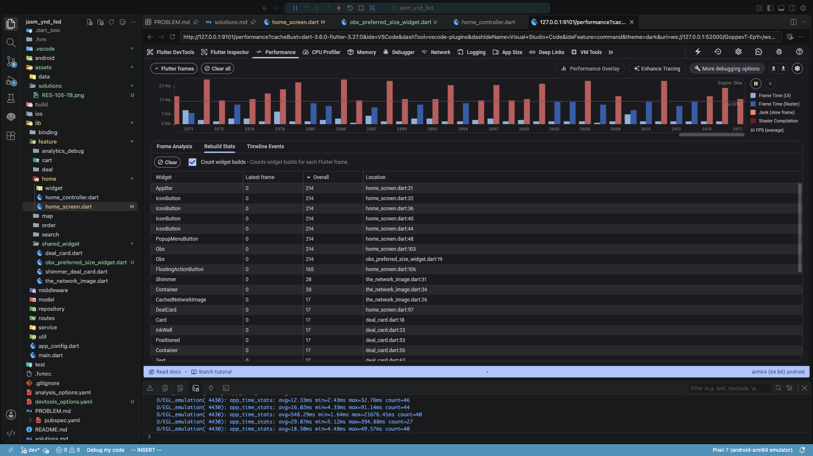
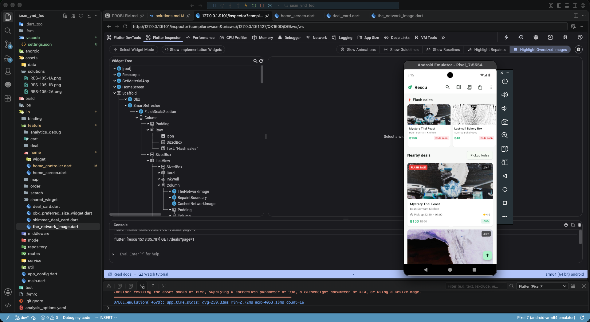

# Part A — Bug tickets

## RES-101 · Search shows results for the wrong query

### Time Spent: ~1 hour

### Root Cause
When user type on TextField, it trigger `TextField.onChanged` and it create new request everytime user typing new value. That make request that take longer to get response can replace matched query results.

### Solution
In `search_deals_controller.dart`, I add debounce timer and wrap around `_search()` method to only start new request when it necessary. And I add search id for tracking latest query request and only let latest request update results and update screen to not make old request overwrite newer results.

## RES-102 · Crash after leaving My orders

### Time Spent: ~10 mins

### Root Cause
In `PickupCountdown` widget, inside `initState()` there is a timer that keep running and update state. And when user close "My orders" page but timer don't get cancel. it will cause a "setState() after dispose" error.

### Solution
Make sure timer got dispose by created new variable that store that timer and inside `dispose()` method, then call `_timer?.cancel()` to stop timer from running. and for safety, I add `mounted` condition check to prevent widget to call setState even if the widget is disposed.

## RES-103 · Requests pile up the longer you browse

### Time Spent: 20 mins

### Root Cause
When user navigate to `DealDetailsScreen` page, it will get `DealDetailsController` and it will trigger `onInit()` method. inside it have `ever()` worker that call `_recheckAvailability()` everytime `cartService.itemCount` changed. but when user navigate back from that page, this worker still in memory and not get dispose and it make everytime user navigate to new deal page it will created more `ever()` worker that will trigger when user try to tap on `Add to bag` button.

### Solution
in `deal_details_controller.dart` file, I add variable to store `ever()` worker and after that I call `.dispose()` inside `onClose()` method to make this worker got disposed when controller is also closed. And I also add check inside `_recheckAvailability()` method by adding `isClosed` condition to prevent results from `dealRepo.fetchById()` to update value when controller already disposed.

## RES-104 · Duplicate deals in the home feed

### Time Spent: 1 hour

### Root Cause
When user try to load more page data. it will call `loadMore()` method and when this request take long time to response and user pull to refresh a page before request finish. `refreshDeals()` method reset page count variable `_page` to 1 while old request is still in flight. when that old request finally finishes, it appends older page data to new refresh list but `_page` variable stay at 1. Then when user load more page data again, `_page` increment to 2 and fetch same page again cause duplicated cards/items.

### Solution
in `home_controller.dart` file, I add variable `loadedPage` to keep track which page each request belongs to. if `_page` does not match `loadedPage` variable, the response is outdated and should be ignored. and I add guard condition like `isClosed` and `refreshController.isRefresh` to prevent duplicate data from being added and prevent update data when controller is disposed.

## RES-105 · Home feed is janky and memory keeps climbing

### Time Spent: 5 hours

### Root Cause 1
in `HomeScreen` widget, it have root `Obx` widget and it cause wide rebuild. that make everytime user scroll it have cause a lot of jank because value of scroll offset and other `.obs` is consistently updated.

### Solution 1
in `home_screen.dart` file. I extracted root `Obx` widget into smaller `Obx` widget and only wrap around part of widget that need to listen to controller. this reduce rebuild a lot but still have jank

| Before | After |
|:--:|:--:|
|||

### Root Cause 2
Updating and checking scroll offset just to show "AppBar elevation" and "FAB scroll to top" added extra work and caused a lot of jank because `Obx` consistently updated on every scroll change

### Solution 2
Remove variable `scrollOffset` and replace with `showAppBarElevation` and `showFABScrollToTop` that only store `true` and `false`. Inside `_onScroll()` method, changed from assigning the offset value to variable to having condition check inside controller and only set boolean value to it. that make `Obx` on HomeScreen update only when actually needed.

| Before | After |
|:--:|:--:|
|||

### Root Cause 3
Image in cards can be oversized compared to the card slot, so decoding them at full size adds extra image decoding and memory work

### Solution 3
In `the_network_image.dart` file, I set `memCacheHeight` scaled by `.devicePixelRatio` so Flutter decodes and caches a smaller size in memory instead of full resolution. This help reduce image decoding and memory load.

| Before | After |
|:--:|:--:|
|||

## RES-106 · Wrong pickup times; "Pickup today" filter misses deals

### Time Spent: 30 mins

### Root Cause
In `pickup_window_model.dart`, `start` and `end` variables are parsed ISO-8601 UTC string, so timezone stays in UTC
- `.label` formatted `start` and `end` without converting to user local time, which showed wrong pickup time on cards
- `.isToday` compared `start.day` (in UTC) with `DateTime.now().day` (in Local Time), and only checked `.day` instead of full date (`year`, `month`, `day`). Because of timezone shift and only checking day, stores with pickup today were filtered out when "Pickup today" was turned on.
- `.isOpenNow` used `now.isAfter(start)`, which excluded the exact opening time.

### Solution
In `pickup_window_model.dart`, I updated getters to use local time instead of UTC for display and time check:
- In `.label`, converted `start.toLocal()` and `end.toLocal()` before formatting with `DateFormat()`
- In `.isToday`, converted `start.toLocal()` and compared `year`, `month` and `day` against `DateTime.now()` so filtering works accurately
- In `.isOpenNow`, changed `now.isAfter(start)` to `!now.isBefore(start)` so the start time is inclusive.

## RES-107 · Deep link opens to a crash

### Time Spent: 4 hours

### Root Cause
When open deal detail page via deep link, `Get.arguments` does not contain a `DealModel` object like normal in-app navigation does. And when `DealDetailsController` tries to cast `Get.arguments as DealModel` while `Get.arguments` is `null`, the app crashes.

### Solution
In `deal_details_controller.dart` file, I updated `DealDetailsController.onInit()` method by extract initialization code into new  `_prepareDeal()` method with safe type checking. It will check if `Get.argumentns` is `DealModel`, use it directly and continue normal flow. Otherwise try to parse deal ID from `Get.parameters["id"]` and fetch deal data via `dealRepo.fetchById()` and use return result to display to user. And I also added loading state while fetching deal so user knows page is still loading and not broken.

# Part B — Features

## F-1 · Live flash-sale countdowns

### Time Spent: ~7 hours

### Implementation
- Added `FlashSaleDealCountdown` widget to display countdown timer, based on the requirement: if the remaining timer is above an hour, I will show time with the format `hh:mm:ss`. Otherwise, it will use the `mm:ss` format. And when the timer is expired or hits `00:00`, then I will show the word "Expired" instead of time.
- Added `CountdownController` to use internally with `FlashSaleDealCountdown` widget. It's a GetxController that stores time data and has methods to start and stop the timer.
- In `FlashSaleDealCountdown` widget, it exposes an `.onExpired` callback that lets you hook a function that will trigger when the timer is expired. In this case, I hook it to update card state to preventing the user from tapping on it, and I hook it to a deal detail page to disable the checkout button.
- In `My bag` page (`cart_screen.dart` file), I redesigned how this page works by separating items that can be checked out and expired items. When items can be checked out, they will display like the old design that this test gave. But when items are expired, they will move to a bottom section called "Expired Items". This section only contains all expired items and can't be increased/decreased, but instead it can only be removed by the user. The reason I designed it this way is because I want to let the user know which items they missed to check out before they expired, and not just vanish out of thin air. And when the user tries to checkout with "active" and "expired" items, only "active" items will get checked out and all "expired" items will still remain on screen, to let the user decide how they want to manage them.

## F-2 · Impression tracking

### Time Spent: ~7 hours

### Implementation
- Added `DealImpressionTracker` widget to wrap any deal widget and track its visibility. When visibility is 50% or more for 1 continuous second, it logs an analytic event via `AnalyticsService.logDealImpression()`.
- In `AnalyticsService`, after `AnalyticsService.logDealImpression()` is called, it checks 2 conditions. First, if queued deal impression events are fewer than 10, a 15-second timer starts; once it reaches 15 seconds, it flushes the queued deal impressions and sends a batch to the API. Second, if queued deal impression events reach 10 or more (whether the timer is running or not), the service cancels the timer and sends a batch to the backend API (max 10 events per API call). After the API call succeeds, the sent items are removed from the queue while unsent items stay in the queue. If items remain, it checks the two conditions again until the queue is empty.

## F-3 · Stock reservations with optimistic UI

### Time Spent: 8 hours

### Implementation
- Added `ReservationCountdown` widget, with the same functionality as `FlashSaleDealCountdown` widget, just a different style.
- Updated cart logic, when a user adds items to the bag, a reservation countdown starts for 5 minutes. When items expire, they move to a bottom section called "Expired Items" (similar to when a Flash Sale Deal expires), with a button to reserve again, restart the timer, and move them back to the top section ready for checkout with the same quantity.

### Expiry Behavior & Product Justification
- Instead of silently deleting expired items from the bag, I move them to the "Expired Items" section so the user doesn't lose their items without warning (especially if it expires right when they tap Checkout) and doesn't have to search for the deal again.
- If an expired item is a flash sale deal, the user can still re-reserve it as long as the flash sale is still active, but once the flash sale ends, the re-reserve option is disabled.

# Part C — Written deliverables

## AI usage log

- **Tools used:** Gemini (for learning how GetX works, asking how things work, brainstorming ideas before I start coding, and proofreading my `solutions.md` text so I don't make typos or write confusing sentences). All code in the project was manually typed by me, not copy-pasted or generated by AI.

- **Examples where AI suggestions didn't fit or needed adjustment:**
  1. **Tight UI space for re-reserving:** AI suggested adding a re-reserve button with clear actions next to expired items, which works in normal layouts, but my UI space was too tight for a full text button. I noticed it wouldn't fit cleanly, so instead I used an icon button with a quantity badge showing how many items will be reserved again, plus a tooltip.
  2. **Flash sale check on expired items:** Early suggestions treated re-reserving mostly around normal quantity/reservation flow, but I caught that if an expired item is a flash sale deal and the flash sale already ended, the user shouldn't be able to re-reserve it. I handled that check myself in my own code and disabled re-reserving once the flash sale ends.

## Design questions

### Q1: In this codebase, what is the difference between a GetxController's lifecycle and a widget State's lifecycle? Name one bug from Part A that exists because of confusion between the two.

- **Difference:** A widget `State` is tied to the widget tree (`initState` when mounted, `build` when rebuilding, `dispose` when removed from the tree), where calling `setState` after `dispose` causes an error. A `GetxController` is managed by GetX's lifecycle (`onInit`, `onReady`, `onClose`) for controller state, reactive workers (`ever`), and async logic not tied to every widget rebuild, and uses `onClose` / `isClosed` instead of `dispose` / `mounted`.
- **Bug from Part A:** **RES-103** (requests piling up when browsing deals). `DealDetailsController` created an `ever()` worker in `onInit()` without disposing it in `onClose()`, leaving active listeners around across navigation and needing `isClosed` checks for async responses instead of treating it like widget `State`.

### Q2: When does wrapping a large subtree in a single Obx hurt you? How do you decide how tightly to scope reactivity?

- **When it hurts:** Wrapping a large subtree in one `Obx` hurts when the `.obs` value changes often (like during scrolling or countdowns) or when the subtree has heavy widgets (like lists or images) it rebuilds parts of the screen that don't need to change, causing jank and extra work (just like in **RES-105**).
- **How I decide scope:** I find where the `.obs` value is actually read, group closely related `.obs` values that belong to the same small UI piece, and wrap an `Obx` around just that part as small as possible without splitting things into tons of tiny `Obx`s when they don't change often.

### Q3: How would you write an automated test that would have caught RES-106 before release? What (if anything) would you change in the code to make such a test possible?

- **How I'd write the test:** I'd write unit tests for `PickupWindowModel` using UTC date strings where UTC time and local device time don't match on the same day, and test `.label` (matches `.toLocal()` formatted time), `.isToday` (matches local `year`, `month`, `day`), and `.isOpenNow` (including when current time equals `start`).
- **Code change to make it possible:** Pass a `now` time (or clock function) into `.isToday` and `.isOpenNow` instead of calling `DateTime.now()` directly inside the model, so tests can control the exact current time deterministically.

## Time spent

- **Rough total time:** Around **37 hours** of active work across **Nov 19 – Nov 24** (assessment sent Nov 18, 15:19 with a 1-week deadline), broken down as roughly **~15 hours** on Part A bugs and **~22 hours** on Part B features (RES-101: ~1h, RES-102: ~10m, RES-103: ~20m, RES-104: ~1h, RES-105: ~5h, RES-106: ~30m, RES-107: ~4h; F-1: ~7h, F-2: ~7h, F-3: ~8h). I didn't work on it continuously because I have a part-time job and fit in time when I could around work.
- **With one more day:** I would polish **F-3** further, such as showing a snackbar when a reserved item expires even if the user is on the Home screen or another page outside "My bag". and do a general code cleanup to make things cleaner.