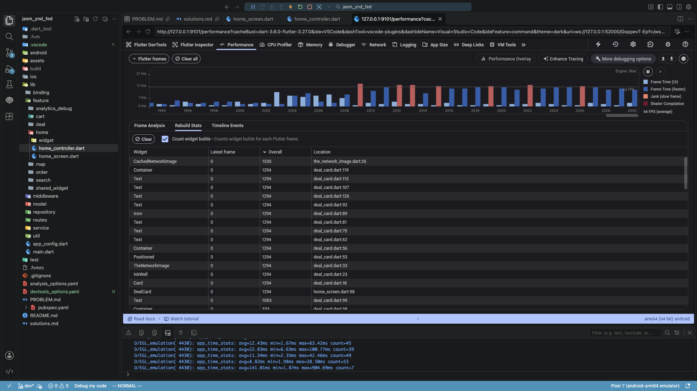
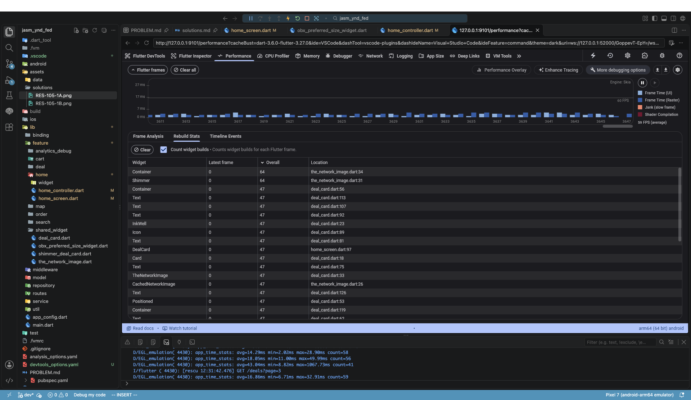
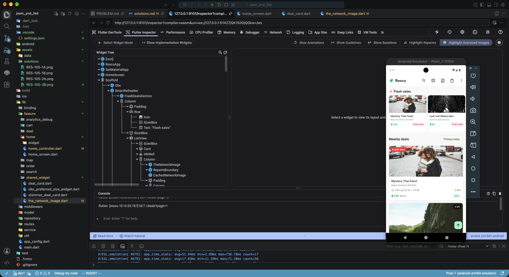

# Part A — Bug tickets

## RES-101 · Search shows results for the wrong query

### Time Spent: ~1 hour

### Root Cause
When user type on TextField, it trigger `TextField.onChanged` and it create new request everytime user typing new value. That make request that take longer to get response can replace matched query results.

### Solution
In `search_deals_controller.dart`, I add debounce timer and wrap around `_search()` method to only start new request when it necessary. And I add search id for tracking latest query request and only let latest request update results and update screen to not make old request overwrite newer results.

## RES-102 · Crash after leaving My orders

### Time Spent: ~10 mins

### Root Cause
In `PickupCountdown` widget, inside `initState()` there is a timer that keep running and update state. And when user close "My orders" page but timer don't get cancel. it will cause a "setState() after dispose" error.

### Solution
Make sure timer got dispose by created new variable that store that timer and inside `dispose()` method, then call `_timer?.cancel()` to stop timer from running. and for safety, I add `mounted` condition check to prevent widget to call setState even if the widget is disposed.

## RES-103 · Requests pile up the longer you browse

### Time Spent: 20 mins

### Root Cause
When user navigate to `DealDetailsScreen` page, it will get `DealDetailsController` and it will trigger `onInit()` method. inside it have `ever()` worker that call `_recheckAvailability()` everytime `cartService.itemCount` changed. but when user navigate back from that page, this worker still in memory and not get dispose and it make everytime user navigate to new deal page it will created more `ever()` worker that will trigger when user try to tap on `Add to bag` button.

### Solution
in `deal_details_controller.dart` file, I add variable to store `ever()` worker and after that I call `.dispose()` inside `onClose()` method to make this worker got disposed when controller is also closed. And I also add check inside `_recheckAvailability()` method by adding `isClosed` condition to prevent results from `dealRepo.fetchById()` to update value when controller already disposed.

## RES-104 · Duplicate deals in the home feed

### Time Spent: 1 hour

### Root Cause
When user try to load more page data. it will call `loadMore()` method and when this request take long time to response and user pull to refresh a page before request finish. `refreshDeals()` method reset page count variable `_page` to 1 while old request is still in flight. when that old request finally finishes, it appends older page data to new refresh list but `_page` variable stay at 1. Then when user load more page data again, `_page` increment to 2 and fetch same page again cause duplicated cards/items.

### Solution
in `home_controller.dart` file, I add variable `loadedPage` to keep track which page each request belongs to. if `_page` does not match `loadedPage` variable, the response is outdated and should be ignored. and I add guard condition like `isClosed` and `refreshController.isRefresh` to prevent duplicate data from being added and prevent update data when controller is disposed.

## RES-105 · Home feed is janky and memory keeps climbing

### Time Spent: 5 hours

### Root Cause 1
in `HomeScreen` widget, it have root `Obx` widget and it cause wide rebuild. that make everytime user scroll it have cause a lot of jank because value of scroll offset and other `.obs` is consistently updated.

### Solution 1
in `home_screen.dart` file. I extracted root `Obx` widget into smaller `Obx` widget and only wrap around part of widget that need to listen to controller. this reduce rebuild a lot but still have jank

| Before | After |
|:--:|:--:|
|||

### Root Cause 2
Updating and checking scroll offset just to show "AppBar elevation" and "FAB scroll to top" added extra work and caused a lot of jank because `Obx` consistently updated on every scroll change

### Solution 2
Remove variable `scrollOffset` and replace with `showAppBarElevation` and `showFABScrollToTop` that only store `true` and `false`. Inside `_onScroll()` method, changed from assigning the offset value to variable to having condition check inside controller and only set boolean value to it. that make `Obx` on HomeScreen update only when actually needed.

| Before | After |
|:--:|:--:|
|||

### Root Cause 3
Image in cards can be oversized compared to the card slot, so decoding them at full size adds extra image decoding and memory work

### Solution 3
In `the_network_image.dart` file, I set `memCacheHeight` scaled by `.devicePixelRatio` so Flutter decodes and caches a smaller size in memory instead of full resolution. This help reduce image decoding and memory load.

| Before | After |
|:--:|:--:|
|||

## RES-106 · Wrong pickup times; "Pickup today" filter misses deals

### Time Spent: 30 mins

### Root Cause
In `pickup_window_model.dart`, `start` and `end` variables are parsed ISO-8601 UTC string, so timezone stays in UTC
- `.label` formatted `start` and `end` without converting to user local time, which showed wrong pickup time on cards
- `.isToday` compared `start.day` (in UTC) with `DateTime.now().day` (in Local Time), and only checked `.day` instead of full date (`year`, `month`, `day`). Because of timezone shift and only checking day, stores with pickup today were filtered out when "Pickup today" was turned on.
- `.isOpenNow` used `now.isAfter(start)`, which excluded the exact opening time.

### Solution
In `pickup_window_model.dart`, I updated getters to use local time instead of UTC for display and time check:
- In `.label`, converted `start.toLocal()` and `end.toLocal()` before formatting with `DateFormat()`
- In `.isToday`, converted `start.toLocal()` and compared `year`, `month` and `day` against `DateTime.now()` so filtering works accurately
- In `.isOpenNow`, changed `now.isAfter(start)` to `!now.isBefore(start)` so the start time is inclusive.